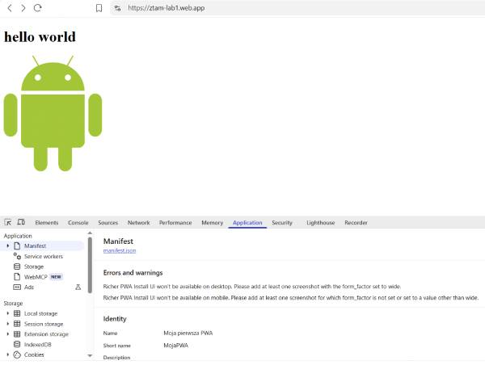
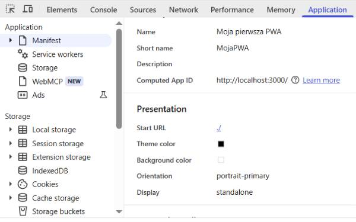
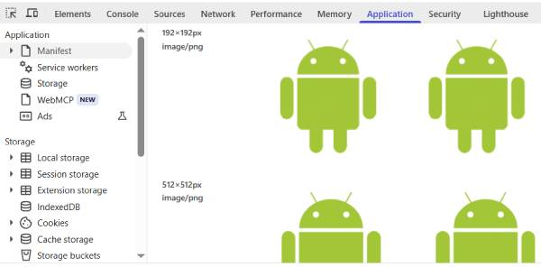
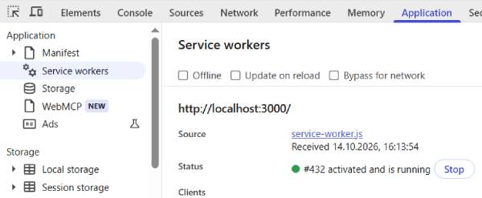
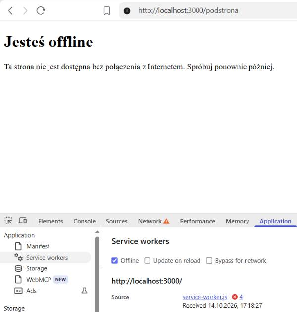
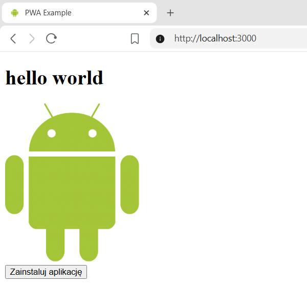
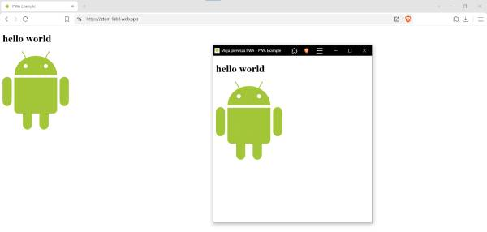
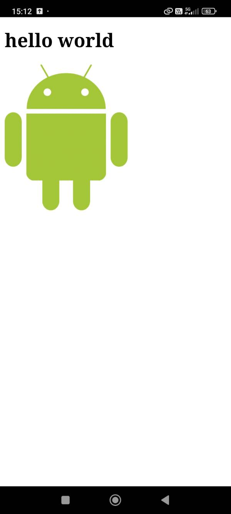
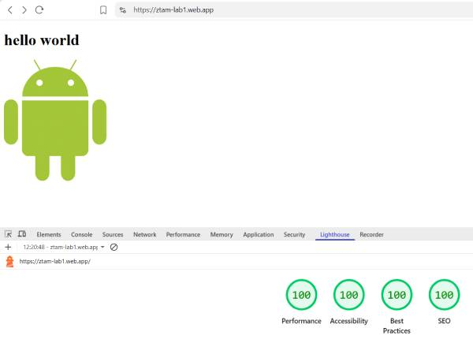

# Lab 01 - Progressive Web App

## Co zostało zrealizowane

Podczas laboratorium przygotowano aplikację PWA, korzystając z technologii HTML i JavaScript. Zawiera ona manifest, ikony i przycisk instalacji.

Service worker wykorzystuje Workbox do zapisywania plików i obrazów w cache oraz obsługi pracy offline. Gdy żądanej strony nie ma w cache i nie można pobrać jej z sieci, wyświetla stronę zastępczą `offline.html`.

Skonfigurowano również Firebase Hosting i opublikowano aplikację.

## Uruchomienie

### Lokalne

#### Wymagania: 

Node.js w wersji LTS co najmniej 22.12 wraz z npm i npx oraz przeglądarka obsługująca aplikacje PWA, np. Google Chrome.

Z głównego katalogu repozytorium `ztam-laboratoria` uruchom:

```bash
cd lab_01
npx serve public
```

Otwórz [http://localhost:3000](http://localhost:3000).

### Firebase

Aplikacja jest dostępna w Firebase Hosting:

[ztam-lab1.web.app](https://ztam-lab1.web.app/).

## Trudności / refleksja

### 1. Manifest i możliwość instalacji

Manifest nie zawiera błędów, a aplikację można zainstalować. Pozostały jedynie dopuszczalne ostrzeżenia o zrzutach ekranu (Richer PWA Install UI).

<details>
<summary>Pokaż obraz</summary>



</details>

### 2. Nazwa, kolory i ikony

Manifest zawiera nazwę aplikacji i kolory.

<details>
<summary>Pokaż obraz</summary>



</details>

<br>

Dodano ikony 192×192 i 512×512 px.

<details>
<summary>Pokaż obraz</summary>



</details>

### 3. Aktywny service worker

Service worker ma status `activated` i obsługuje cache przez Workbox.

<details>
<summary>Pokaż obraz</summary>



</details>

### 4. Działanie offline

Po odświeżeniu w trybie offline aplikacja korzysta z cache. Nieznana podstrona wyświetla własną stronę `offline.html`.

<details>
<summary>Pokaż obraz</summary>



</details>

### 5. Własny przycisk instalacji

Przycisk „Zainstaluj aplikację” działa w Chrome i jest ukryty w przeglądarkach, które go nie obsługują.

<details>
<summary>Pokaż obraz</summary>



</details>

### 6. Publikacja i instalacja na telefonie

Aplikację opublikowano przez HTTPS na [Firebase Hosting](https://ztam-lab1.web.app/) i zainstalowano na komputerze.

<details>
<summary>Pokaż obraz</summary>



</details>

<br>

Zainstalowana aplikacja działa również na telefonie.

<details>
<summary>Pokaż obraz</summary>



</details>

### 7. Wynik Lighthouse

Raport Lighthouse pokazuje 100 we wszystkich kategoriach, w tym Accessibility i Best Practices. Dodano role strukturalne (`banner`, `main`, `contentinfo`) oraz meta tag `description`.

<details>
<summary>Pokaż obraz</summary>



</details>
