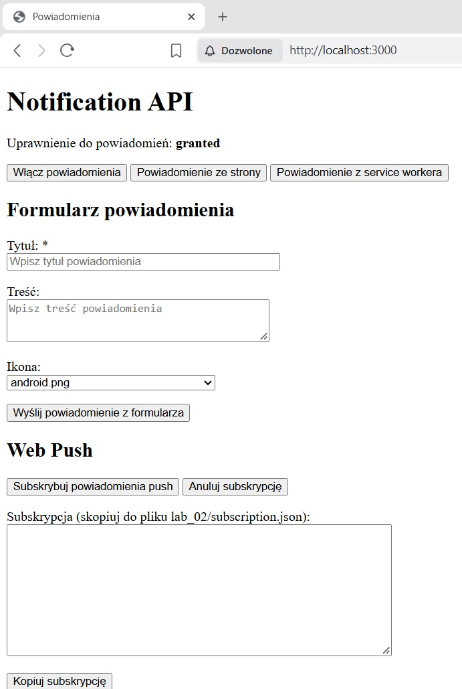
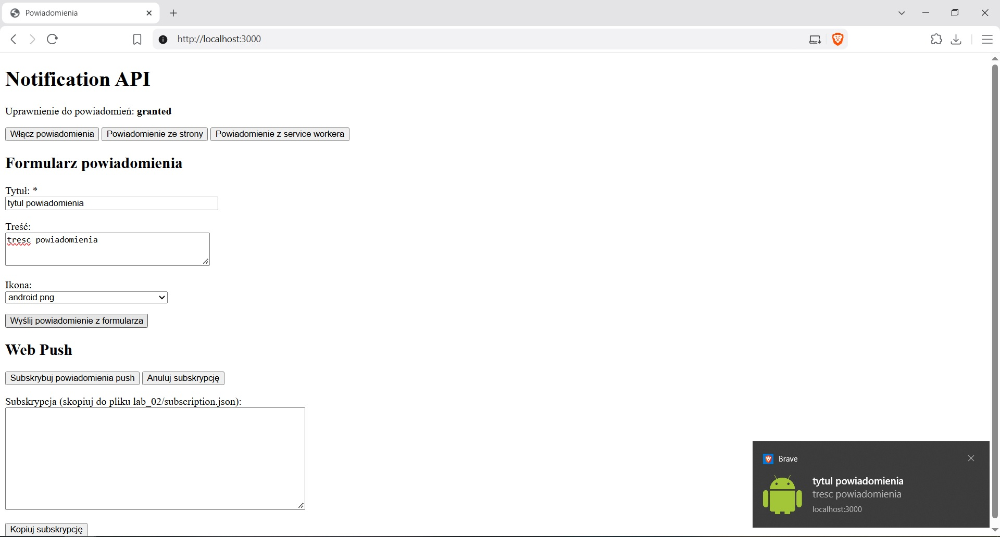
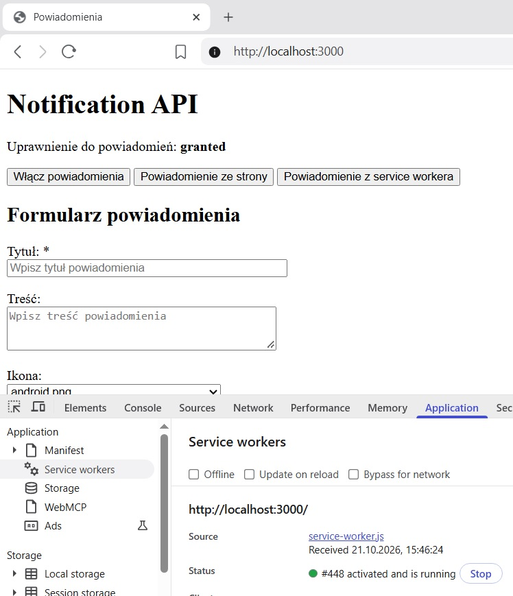
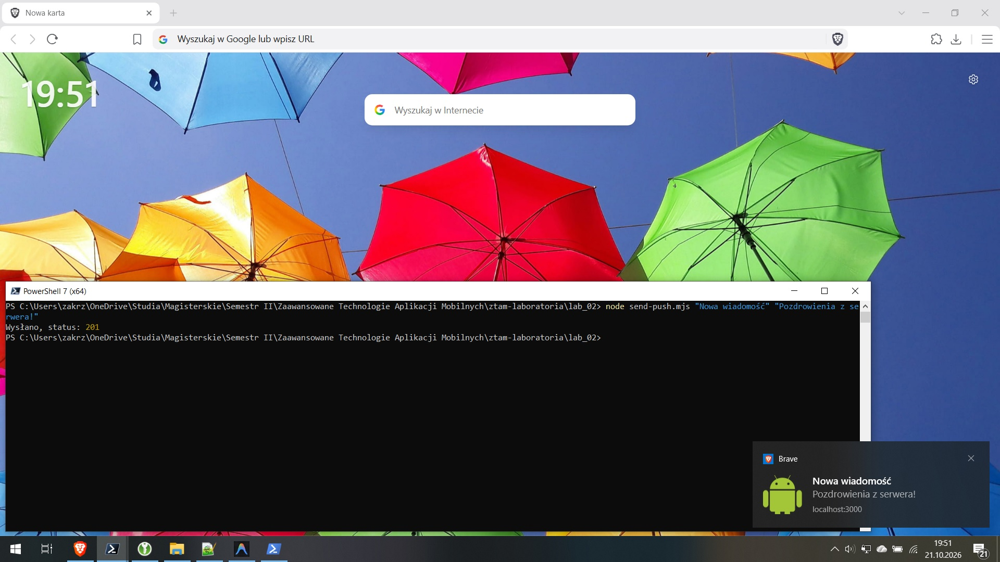
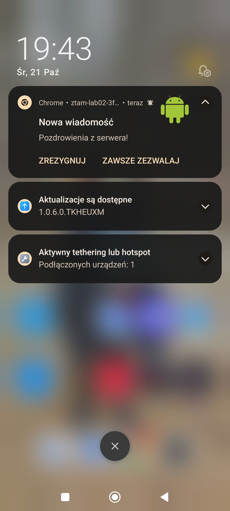

# Lab 02 - Powiadomienia i Web Push

## Co zostało zrealizowane

Podczas laboratorium przygotowano aplikację PWA z powiadomieniami tworzonymi przez stronę i service workera. Formularz pozwala podać tytuł, treść i wybrać ikonę. Pusty tytuł blokuje wysłanie, a kliknięcie powiadomienia otwiera aplikację.

Dodano subskrypcję i anulowanie subskrypcji Web Push oraz skrypt Node.js do wysyłania wiadomości. Powiadomienia docierają również po zamknięciu karty aplikacji.

Skonfigurowano Firebase Hosting i sprawdzono odbiór powiadomienia push na telefonie. Klucz prywatny VAPID i dane subskrypcji są wykluczone z repozytorium.

## Uruchomienie

### Lokalne

#### Wymagania:

Node.js w wersji LTS co najmniej 22.12 wraz z npm i npx oraz przeglądarka obsługująca powiadomienia i Web Push, np. Google Chrome.

Z głównego katalogu repozytorium `ztam-laboratoria` uruchom:

```bash
cd lab_02/public
npx serve
```

Otwórz adres podany w terminalu, np. [http://localhost:3000](http://localhost:3000).

W drugim terminalu, z głównego katalogu repozytorium, uruchom:

```bash
cd lab_02
npm install web-push
node generate-keys.mjs
```

Klucz publiczny wypisany przez skrypt powinien być zapisany jako `VAPID_PUBLIC_KEY` w `public/notification.js`. W aplikacji zezwól na powiadomienia, kliknij „Subskrybuj powiadomienia push”, a następnie „Kopiuj subskrypcję”. Zapisz JSON jako `lab_02/subscription.json`.

Z katalogu `lab_02` wyślij powiadomienie:

```bash
node send-push.mjs "Nowa wiadomość" "Pozdrowienia z serwera!"
```

### Firebase

Aplikacja jest dostępna w Firebase Hosting:

[ztam-lab02-3f832.web.app](https://ztam-lab02-3f832.web.app/).

## Trudności / refleksja

### 1. Uprawnienia do powiadomień

Aplikacja pyta o zgodę po działaniu użytkownika. Aktualny stan (`default`, `granted` lub `denied`) jest widoczny na stronie.

<details>
<summary>Pokaż obraz</summary>



</details>

### 2. Formularz i walidacja

Formularz zawiera tytuł, treść i wybór jednej z czterech ikon. Powiadomienie wyświetla service worker. Pusty tytuł i same spacje nie powodują wysłania powiadomienia.

<details>
<summary>Pokaż obraz</summary>



</details>

### 3. Aktywny service worker

Service worker obsługuje powiadomienia i zdarzenie `push`. Kliknięcie powiadomienia otwiera aplikację.

<details>
<summary>Pokaż obraz</summary>



</details>

### 4. Web Push po zamknięciu karty

Wiadomość wysłana skryptem `send-push.mjs` dociera po zamknięciu karty aplikacji, przy uruchomionej przeglądarce. Przycisk „Anuluj subskrypcję” usuwa subskrypcję i czyści jej pole na stronie.

<details>
<summary>Pokaż obraz</summary>



</details>

### 5. Powiadomienie na telefonie

Aplikacja działa przez HTTPS. Push wysłany na subskrypcję utworzoną na telefonie dociera po zamknięciu karty, a kliknięcie powiadomienia otwiera aplikację. Na Androidzie używane są powiadomienia z service workera.

<details>
<summary>Pokaż obraz</summary>



</details>

### 6. Klucze VAPID

Pliki `vapid-keys.json` i `subscription.json` znajdują się poza folderem `public` i są ignorowane przez Git. Publikowany jest tylko klucz publiczny potrzebny do subskrypcji.

### +++ Powiadomienia w Brave +++

W przeglądarce Brave konieczne było włączenie opcji „Use Google services for push messaging” w ustawieniach prywatności, aby działały powiadomienia Web Push. Samo zezwolenie na powiadomienia dla strony nie wystarczało.
