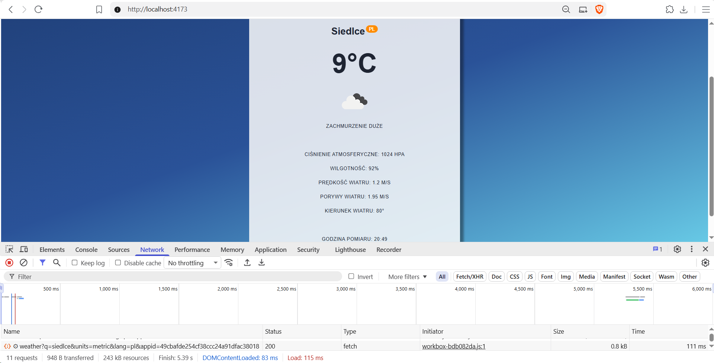
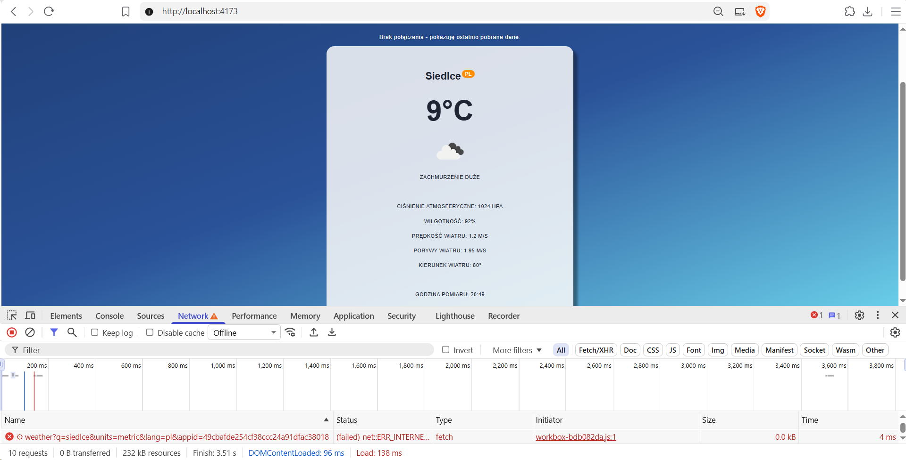
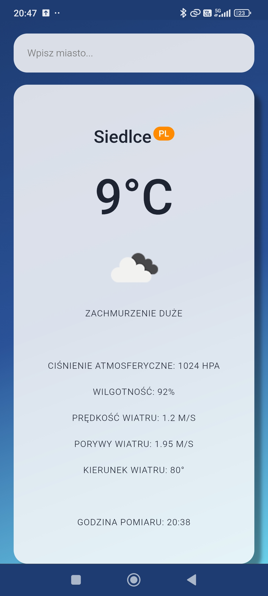

# Lab 03 - Aplikacja pogodowa i komunikacja sieciowa w PWA

## Co zostało zrealizowane

- Aplikacja React + Vite pobierająca pogodę z OpenWeatherMap przez `fetch()`.
- Karta miasta: temperatura, ikona i opis pogody, ciśnienie, wilgotność, prędkość, porywy i kierunek wiatru oraz godzina pomiaru.
- Obsługa pustego pola, stanu ładowania i błędów: nieznane miasto, nieaktywny klucz API, brak sieci.
- PWA z manifestem i ikonami. Dodatkowe zrzuty umożliwiają wyświetlenie podglądu aplikacji w rozszerzonym oknie instalacji PWA. Service worker buforuje odpowiedzi API (`NetworkFirst`) i ikony pogody (`CacheFirst`); aplikacja informuje o utracie połączenia.

## Uruchomienie

Wymagania: Node.js z npm, przeglądarka obsługująca PWA (np. Chrome) oraz aktywny klucz OpenWeatherMap wpisany jako `API_KEY` w `src/api/fetchWeather.js`.

Z głównego katalogu repozytorium `ztam-laboratoria` uruchom:

```bash
cd lab_03
npm install
npm run build
npm run preview
```

Otwórz adres podany w terminalu, np. [http://localhost:4173](http://localhost:4173).

Service worker działa w wersji produkcyjnej (`build` + `preview`). Po zmianie kodu ponownie wykonaj `npm run build`. Tryb `npm run dev` nie obsługuje offline.

Dodatkowo opublikowano aplikację na Firebase Hosting: [ztam-lab03-tz.web.app](https://ztam-lab03-tz.web.app/).

## Trudności / refleksja

Tryb offline wymaga wcześniejszego pobrania pogody dla danego miasta. Bez zapisanej odpowiedzi pojawia się błąd połączenia. Godzina pomiaru pozwala ocenić aktualność danych z cache.

## Zrzuty ekranu

### 1. Pogoda dla wybranego miasta

Pogoda dla Siedlec pobrana online, wraz z dodatkowymi parametrami i godziną pomiaru.

<details>
<summary>Pokaż obraz</summary>



</details>

### 2. Działanie w trybie offline

Po włączeniu `Offline` w DevTools dane dla Siedlec pochodzą z cache service workera. Nad kartą pojawia się informacja o braku połączenia.

<details>
<summary>Pokaż obraz</summary>



</details>

### 3. Aplikacja na telefonie

<details>
<summary>Pokaż obraz</summary>



</details>
