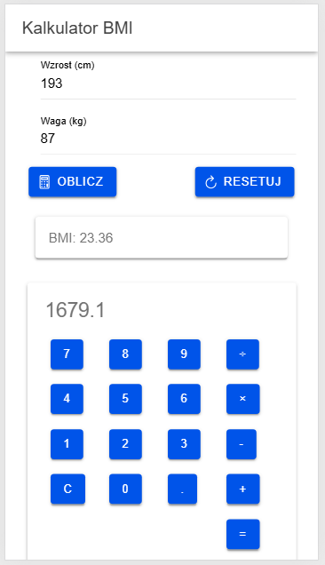

# Lab 04 - Ionic React: BMI i kalkulator

## Co zostało zrealizowane

Przygotowano aplikację Ionic React z kalkulatorem BMI: polami wzrostu i wagi, wynikiem w karcie oraz przyciskiem resetowania.

Dodano osobny komponent `Kalkulator.tsx` z czterema działaniami i wyświetlaczem opartym na `useState`. Wynik można wykorzystać w kolejnym działaniu. Przycisk `C` czyści dane, druga kropka jest ignorowana, a dzielenie przez zero wyświetla komunikat błędu. Obliczenia opierają się na instrukcji `switch`.

## Uruchomienie

Wymagania: Node.js z npm oraz Ionic CLI.

Z głównego katalogu repozytorium `ztam-laboratoria` uruchom:

```bash
cd lab_04
npm install
ionic serve
```

Otwórz adres podany w terminalu, np. [http://localhost:8100](http://localhost:8100).

## Trudności / refleksja

Przy wpisywaniu drugiej liczby trzeba zastąpić zawartość wyświetlacza zamiast dopisywać do pierwszej. Osobny stan pozwala też rozpocząć nowy wpis po wyniku, a reset `C` czyści zarówno ekran, jak i zapamiętane działanie.

## Zrzuty ekranu

### 1. Kalkulator BMI oraz Kalkulator

<details>
<summary>Pokaż obraz</summary>



</details>
