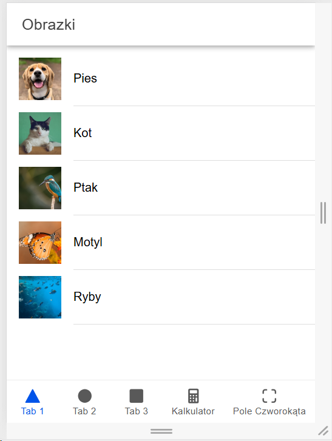
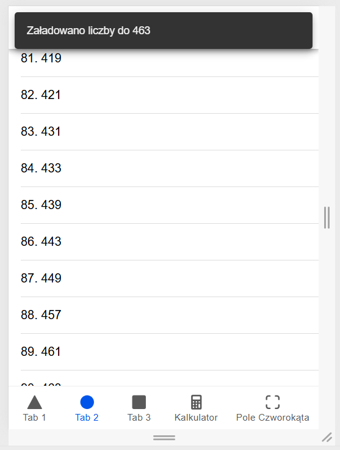
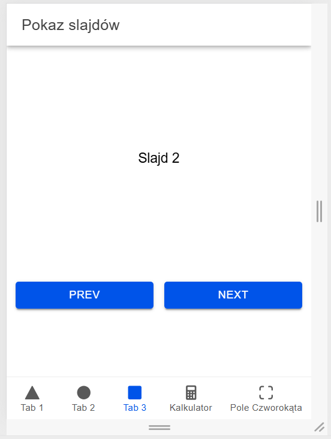
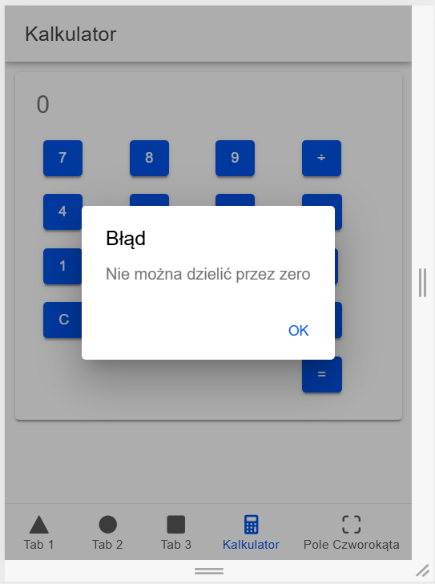
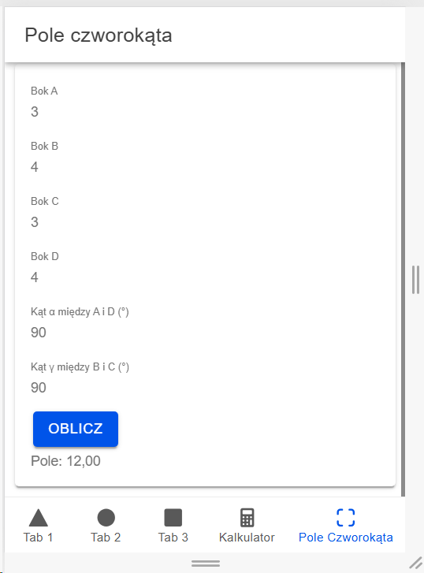

# Lab 05 - Podstawowe komponenty Ionic React

## Co zostało zrealizowane

Przygotowano aplikację Ionic React z pięcioma zakładkami:

- Zadania 1-2: Kalkulator przeniesiony z poprzednich zajęć. Dzielenie przez zero wyświetla okno `IonAlert`.
- Zadanie 3: Lista obrazków z podpisami i miniaturami.
- Zadanie 4: Lista liczb pierwszych: 30 liczb na start, a po przewinięciu wczytywane kolejne 20.
- Zadanie 5: Pokaz trzech slajdów w bibliotece Swiper, sterowany gestem lub przyciskami PREV i NEXT.
- Zadanie 6: Formularz obliczający pole czworokąta ze wzoru Bretschneidera. Dodany w osobnym komponencie `PoleCzworokata.tsx`.

## Uruchomienie

Wymagania: Node.js z npm oraz Ionic CLI.

Z głównego katalogu repozytorium `ztam-laboratoria` uruchom:

```bash
cd lab_05
npm install
ionic serve
```

Otwórz adres podany w terminalu, np. [http://localhost:8100](http://localhost:8100).

## Zrzuty ekranu

### Tab 1. Lista obrazków

<details>
<summary>Pokaż obraz</summary>



</details>

### Tab 2. Liczby pierwsze

<details>
<summary>Pokaż obraz</summary>



</details>

### Tab 3. Pokaz slajdów

<details>
<summary>Pokaż obraz</summary>



</details>

### Tab 4. Kalkulator

<details>
<summary>Pokaż obraz</summary>



</details>

### Tab 5. Pole czworokąta

<details>
<summary>Pokaż obraz</summary>



</details>
