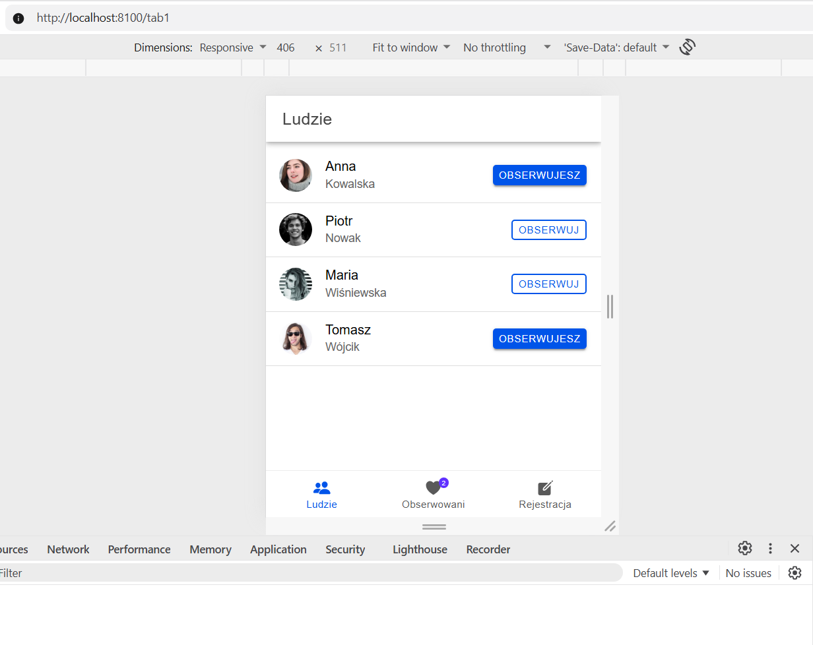
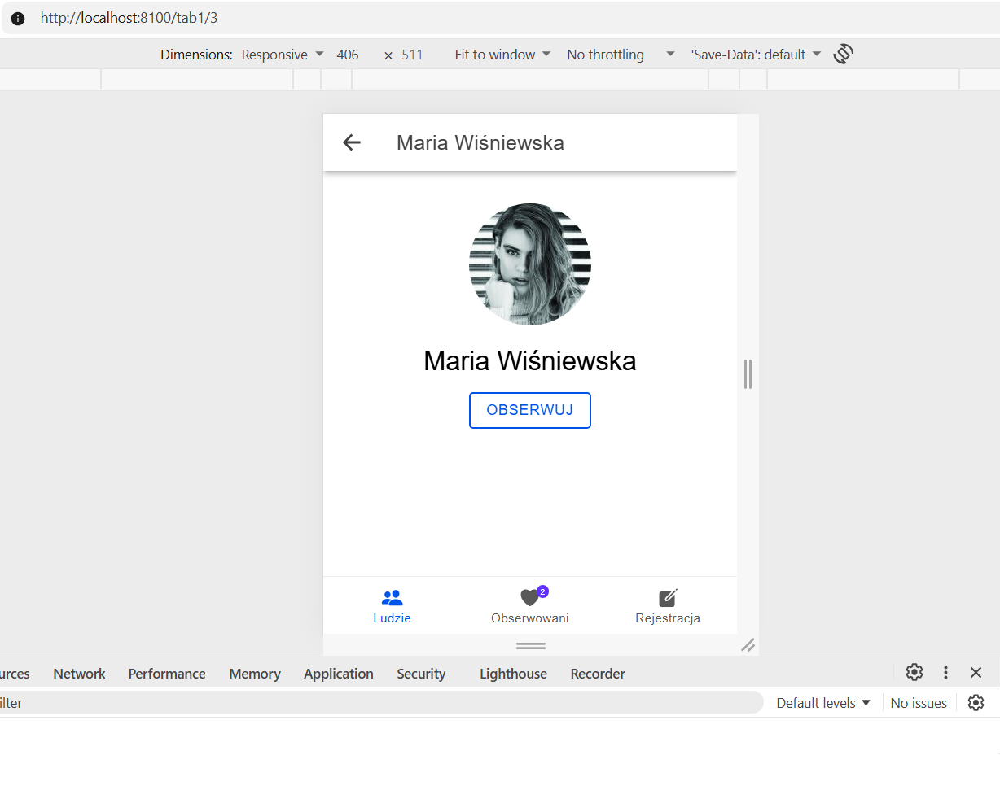
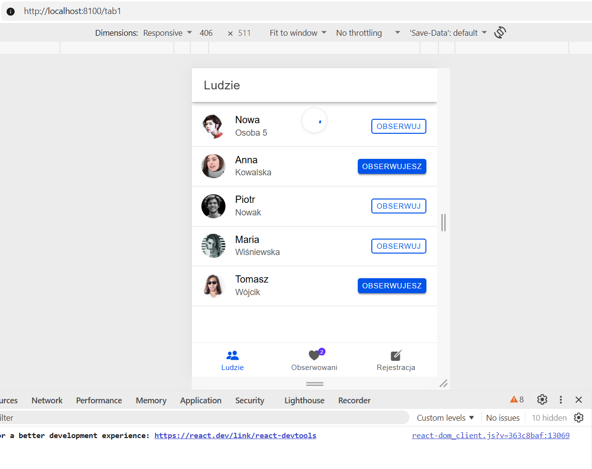
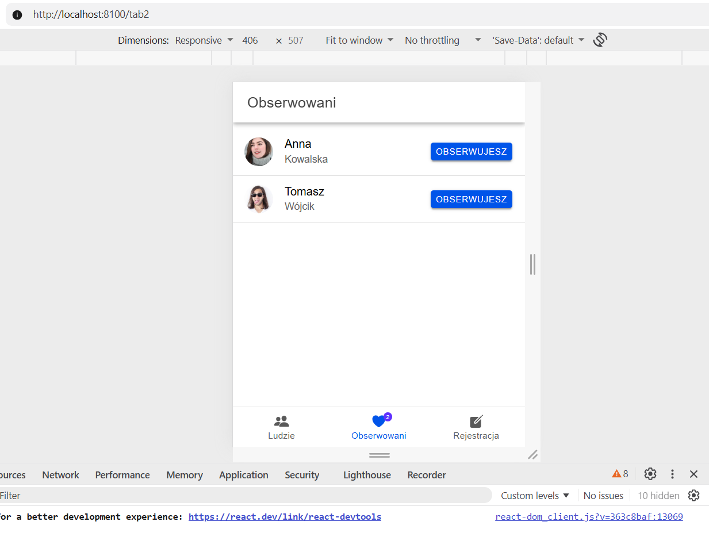
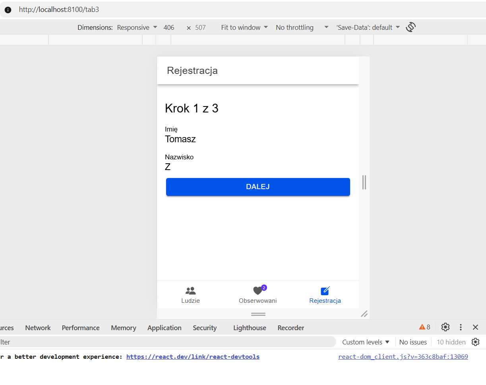
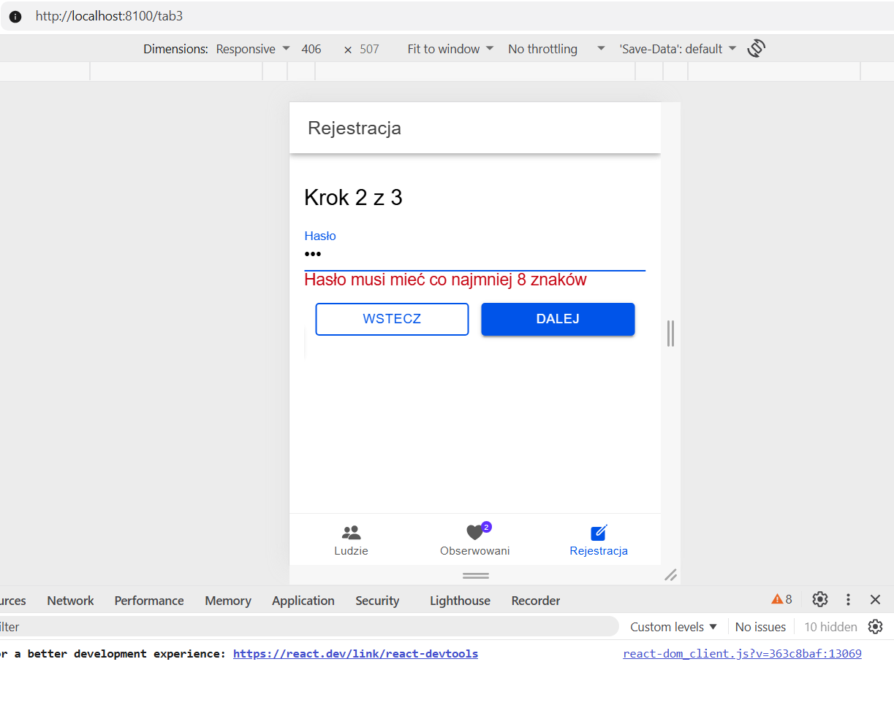
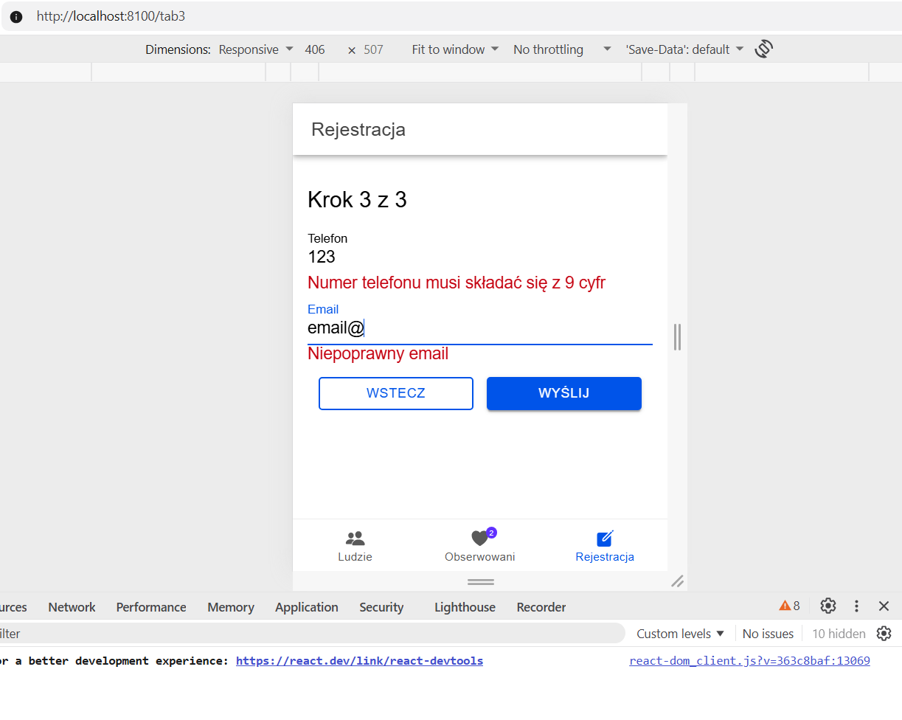
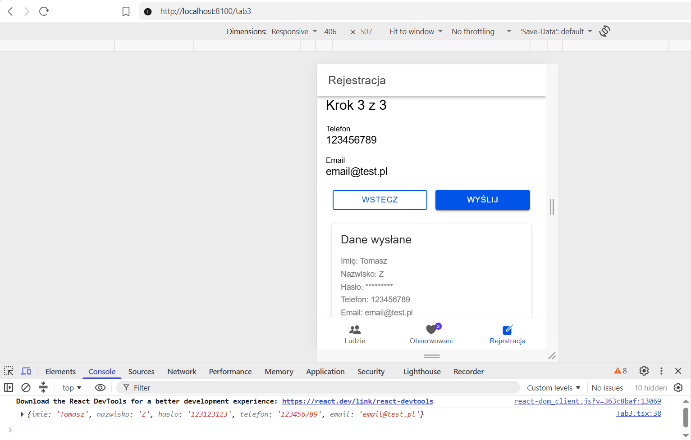

# Lab 06 - Nawigacja, wspólny stan i formularze w Ionic React

## Co zostało zrealizowane

Aplikacja Ionic React z zakładkami Ludzie, Obserwowani i Rejestracja.

- Zadanie 1: Lista osób i obserwowanych ze wspólnym stanem Zustand.
- Zadanie 2: Szczegóły osoby pod adresem `/tab1/:id` i powrót do listy.
- Zadanie 3: Odświeżanie listy przez `IonRefresher` z dodaniem nowej osoby.
- Zadanie 4: Formularz w trzech krokach z walidacją (react-hook-form i Swiper).
- Zadanie 5: Karta z wysłanymi danymi i zamaskowanym hasłem.

Dodatkowo: walidacja numeru telefonu (9 cyfr) i licznik obserwowanych (`IonBadge`).

## Uruchomienie

Wymagania: Node.js z npm oraz Ionic CLI.

Z głównego katalogu repozytorium `ztam-laboratoria` uruchom:

```bash
cd lab_06
npm install
ionic serve
```

Otwórz adres podany w terminalu, np. [http://localhost:8100](http://localhost:8100).

## Zrzuty ekranu

### Tab 1. Lista osób

<details>
<summary>Pokaż obraz</summary>



</details>

### Tab 1. Szczegóły osoby

<details>
<summary>Pokaż obraz</summary>



</details>

### Tab 1. Lista po odświeżeniu

<details>
<summary>Pokaż obraz</summary>



</details>

### Tab 2. Obserwowani

<details>
<summary>Pokaż obraz</summary>



</details>

### Tab 3. Formularz - imię i nazwisko

<details>
<summary>Pokaż obraz</summary>



</details>

### Tab 3. Formularz - walidacja hasła

<details>
<summary>Pokaż obraz</summary>



</details>

### Tab 3. Formularz - walidacja telefonu i e-maila

<details>
<summary>Pokaż obraz</summary>



</details>

### Tab 3. Podsumowanie wysłanych danych

<details>
<summary>Pokaż obraz</summary>



</details>
